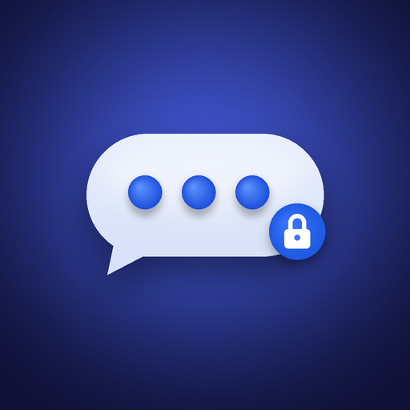
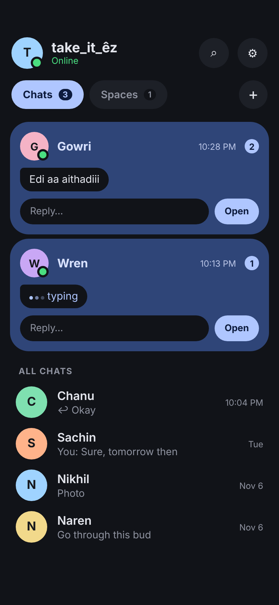
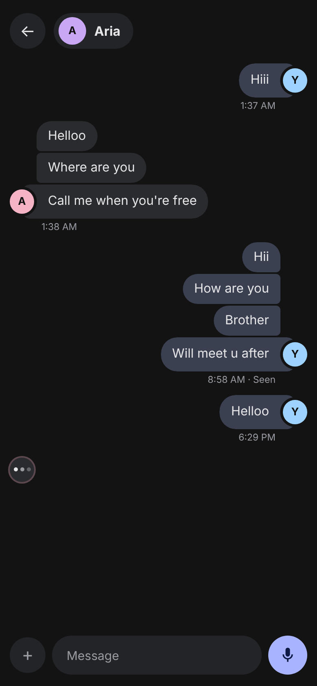
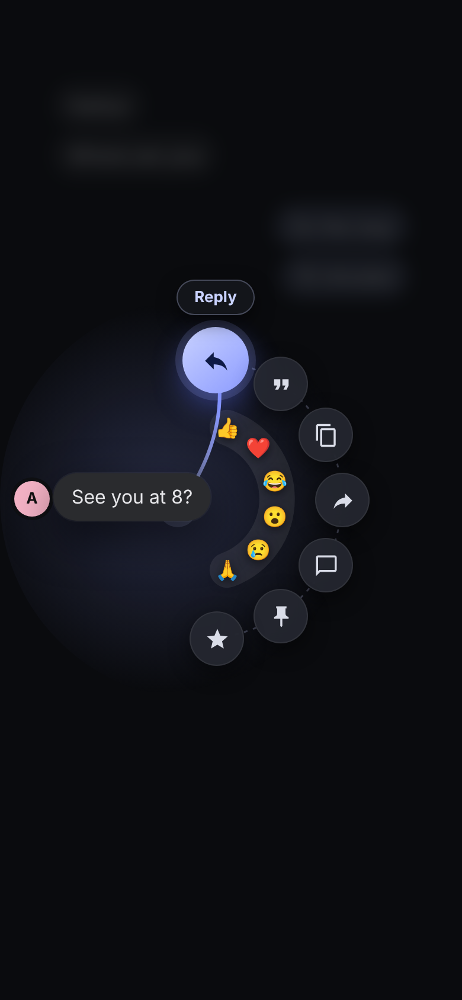
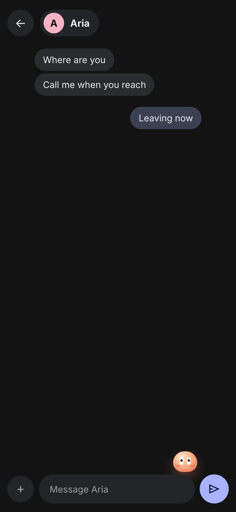

[](https://github.com/blackshadowde/Keepr/releases/latest)
[](https://github.com/blackshadowde/Keepr/releases)
[](https://github.com/blackshadowde/Keepr/actions/workflows/vibe-security.yml)
[](LICENSE)
[](https://matrix.org)

<p align="center">
  
</p>

<h1 align="center">Keepr</h1>

<p align="center">
  A private messenger for the people you talk to every day.<br>
  End-to-end encrypted, no phone number, no ads, open source.
</p>

<p align="center">
  <a href="https://github.com/blackshadowde/Keepr/releases/latest"></a>
  <a href="https://apps.obtainium.imranr.dev/redirect?r=obtainium://add/https://github.com/blackshadowde/Keepr"></a>
</p>

<p align="center">
  <a href="https://get-keepr.github.io">Website</a> ·
  <a href="#iphone">iPhone</a> ·
  <a href="https://blackshadowde.github.io/Keepr/">Web app</a> ·
  <a href="CHANGELOG.md">Changelog</a> ·
  <a href="PRIVACY.md">Privacy</a>
</p>

Keepr is a chat app for Android, iPhone and the web. It runs on [Matrix](https://matrix.org), an open and decentralised network, so your account lives on a server you choose and you can talk to people on any other Matrix server.

## Contents

- [Screenshots](#screenshots)
- [Features](#features)
- [Security](#security)
- [Install](#install)
- [Verifying a download](#verifying-a-download)
- [Building](#building)
- [Contributing](#contributing)
- [Supporting Keepr](#supporting-keepr)
- [Copyright and license](#copyright-and-license)

## Screenshots

| Home | Chat | Message menu | Typing buddy |
|:-:|:-:|:-:|:-:|
|  |  |  |  |

## Features

**Messaging**
- Direct chats, groups and communities with channels and threads
- Replies, quotes of part of a message, edits, reactions, polls and pinned messages
- View once messages and media
- Voice messages, photos, videos and files, including large files sent in parts
- Location sharing, live location for a set time, and check-in
- Encrypted voice and video calls
- Scheduled messages and disappearing messages

**Everyday**
- Custom status with an end time, and the other person's local time in a chat
- Locked chats behind your fingerprint, with hidden notifications
- Low data mode
- A typing buddy that reacts to the chat, kept entirely on your phone
- Themes that follow your phone's colours

**Accounts and notifications**
- Any Matrix server, or create an account in the app
- Notifications through a direct connection to your server or through ntfy, with no Google services required
- Key backup and recovery with a recovery key

## Security

- **End-to-end encryption.** Messages and files are encrypted with Olm and Megolm through [vodozemac](https://github.com/matrix-org/vodozemac). Your server stores only encrypted data.
- **Strict key rotation.** New chats use a fresh Megolm key for every message, so a single leaked key exposes as little as possible. Other Matrix apps can still read these chats.
- **Post-quantum direct chats.** When every device in a direct chat runs Keepr, text messages get a second layer inside the Matrix encryption: a chat key exchanged with ML-KEM-768 (FIPS 203) and messages sealed with AES-256-GCM. ML-KEM comes from [libcrux](https://github.com/cryspen/libcrux), a formally verified implementation; AES-GCM and HKDF come from [RustCrypto](https://github.com/RustCrypto). If any device uses another app, Keepr falls back to normal encryption so nothing becomes unreadable. Details: [docs/post-quantum.md](docs/post-quantum.md).
- **No tracking.** Keepr has no analytics and no ads. Push notifications carry only a room and event ID, never message text. Every service Keepr contacts is listed in [PRIVACY.md](PRIVACY.md).

Found a vulnerability? Please report it privately as described in [SECURITY.md](SECURITY.md).

## Install

### Android

Download `Keepr-x.y.z.apk` from the [latest release](https://github.com/blackshadowde/Keepr/releases/latest) and open it. Android 10 or newer on a 64-bit phone is required.

To get updates automatically, add `https://github.com/blackshadowde/Keepr` in [Obtainium](https://obtainium.imranr.dev). You can also check for updates in Settings > About.

### iPhone

Keepr for iPhone installs through [SideStore](https://sidestore.io) or [AltStore](https://altstore.io). Add this source, then install Keepr from it:

```
https://raw.githubusercontent.com/blackshadowde/Keepr/Vibe/altstore.json
```

### Web

Keepr runs in the browser at [blackshadowde.github.io/Keepr](https://blackshadowde.github.io/Keepr/).

## Verifying a download

Every release is built by GitHub Actions from this repository, and the build logs are public. The release notes list the APK's SHA-256 and a [VirusTotal](https://www.virustotal.com) report. To check a file yourself:

```sh
sha256sum Keepr-x.y.z.apk
```

The weekly security workflow runs [MobSF](https://github.com/MobSF/Mobile-Security-Framework-MobSF) against the OWASP MASVS (0 of 432 known trackers), OSV-Scanner on every dependency, and CodeQL on the build workflows. Reports are attached to each run.

## Building

Keepr is a Flutter app. You need:

- Flutter (the version is in [`.tool_versions.yaml`](.tool_versions.yaml))
- Rust, for the encryption libraries (installed with [rustup](https://rustup.rs))
- The Android SDK and NDK, or Xcode for iPhone

```sh
git clone https://github.com/blackshadowde/Keepr.git
cd Keepr
flutter pub get
flutter run
```

The post-quantum module is a small Rust crate in [`packages/keepr_pq`](packages/keepr_pq). Its tests run with `cargo test` in `packages/keepr_pq/rust`.

GitHub Actions workflows:

| Workflow | What it does |
| --- | --- |
| Keepr check | Analyzes the code and tests the Rust module, about 3 minutes |
| Keepr build | Debug APK for testing |
| Keepr release | Signed APK; optionally publishes a GitHub release |
| Keepr iOS | Unsigned IPA; optionally updates the AltStore source |
| Keepr web | Builds the web app and deploys it to GitHub Pages |
| Keepr security scans | MobSF, OSV-Scanner and CodeQL |

Release signing uses these repository secrets:

| Secret | Purpose |
| --- | --- |
| `ANDROID_KEYSTORE_BASE64` | Signing keystore, base64 encoded |
| `ANDROID_KEYSTORE_PASSWORD` | Keystore password |
| `VT_API_KEY` | VirusTotal API key (optional) |

Keep the keystore backed up outside the repository. Without it, installed copies can't be updated.

## Contributing

Bug reports and ideas are welcome in [Issues](https://github.com/blackshadowde/Keepr/issues). Please search for an existing issue first. For code changes, see [CONTRIBUTING.md](CONTRIBUTING.md).

## Supporting Keepr

Keepr is free and has no ads. If you'd like to support its development, you can donate by UPI:

<p align="center">
  <br>
  <code>ashish.boddu@ybl</code>
</p>

## Copyright and license

Copyright © 2026 Keepr contributors.

Keepr is licensed under the [GNU Affero General Public License v3.0 or later](LICENSE). It started from [FluffyChat](https://github.com/krille-chan/fluffychat) by Christian Kußowski and contributors (AGPL-3.0-or-later), whose copyright notices are kept in the source.

Bundled fonts and assets keep their own licenses, listed in [LICENSES](LICENSES) and in the app under About > Open-source licences. Matrix is an open standard from the [Matrix.org Foundation](https://matrix.org). Other names belong to their owners.
